# Layout recipes

shadcn/ui has no grid system and no grid component. Its originals repeat a few layout recipes made of Tailwind utilities and container queries, and a page looks like shadcn when it uses the same ones. Each recipe below comes from a named original; `scripts/gen_layout_reference.py` checks that its classes appear together in that original before writing this page, and the page check (`compliance/scripts/check_page.py`) reports any grid, gap, padding, margin or width value that no original uses.

## Rules the originals follow

- **Containers decide layout.** The page column is `@container/main` and cards are `@container/card`; rows and card parts switch on those widths (`@xl/main:`, `@5xl/main:`, `@[540px]/card:`). Window breakpoints (`md:`, `lg:`) are used for the page frame, split screens and the chart grid.
- **Spacing comes from one short scale.** Regions are `gap-4`, `md:gap-6` apart; page rows are inset `px-4 lg:px-6`; card parts use the card recipe and are not padded again.
- **Rows follow the original's count.** Four stat cards; three content tiles (five in sidebar-12); two or three chart cards; two paired fields. Wider pages split into tabs or linked pages instead of adding columns.

## Values in use

| Kind | Values the originals use |
|---|---|
| Gap | `gap-0`, `gap-1`, `gap-2`, `gap-3`, `gap-4`, `gap-6`, `gap-7`, `gap-8`, `gap-10`, `gap-12`, `gap-24`, `gap-0.5`, `gap-1.5`, `gap-2.5`, `gap-3.5`, `gap-[--spacing(var(--gap))]` |
| Padding | `p-0`, `p-1`, `p-2`, `p-3`, `p-4`, `p-6`, `p-8`, `p-0!`, `p-10`, `p-12`, `pb-0`, `pb-3`, `pb-4`, `pb-6`, `pl-1`, `pl-4`, `pl-6`, `pl-7`, `pl-8`, `pt-0`, `pt-2`, `pt-3`, `pt-4`, `pt-6`, `pt-8`, `px-0`, `px-1`, `px-2`, `px-3`, `px-4`, `px-6`, `px-8`, `py-0`, `py-1`, `py-2`, `py-3`, `py-4`, `py-5`, `py-6`, `py-0!` |
| Columns | `2xl:grid-cols-1`, `@5xl/main:grid-cols-4`, `@xl/main:grid-cols-2`, `grid-cols-1`, `grid-cols-1!`, `grid-cols-2`, `grid-cols-3`, `grid-cols-subgrid`, `in-data-numbered:grid-cols-subgrid`, `lg:grid-cols-1`, `lg:grid-cols-2`, `lg:grid-cols-3`, `md:grid-cols-1`, `md:grid-cols-2`, `md:grid-cols-3`, `md:grid-cols-5`, `sm:grid-cols-2` |
| Maximum width | `max-w-2xl`, `max-w-3xl`, `max-w-4xl`, `max-w-5xl`, `max-w-6xl`, `max-w-80`, `max-w-96`, `max-w-fit`, `max-w-full`, `max-w-lg`, `max-w-max`, `max-w-md`, `max-w-none`, `max-w-sm`, `max-w-xl`, `max-w-xs` |

## Page column

From `dashboard-01`. The content column of a signed-in page, inside the sidebar inset. The column is a container (`@container/main`), so the rows inside respond to its width, not the window. Every row carries its own side padding `px-4 lg:px-6`.

```html
<div class="flex flex-1 flex-col">
  <div class="@container/main flex flex-1 flex-col gap-2">
    <div class="flex flex-col gap-4 py-4 md:gap-6 md:py-6">
      <div class="px-4 lg:px-6"> …a row… </div>
    </div>
  </div>
</div>
```

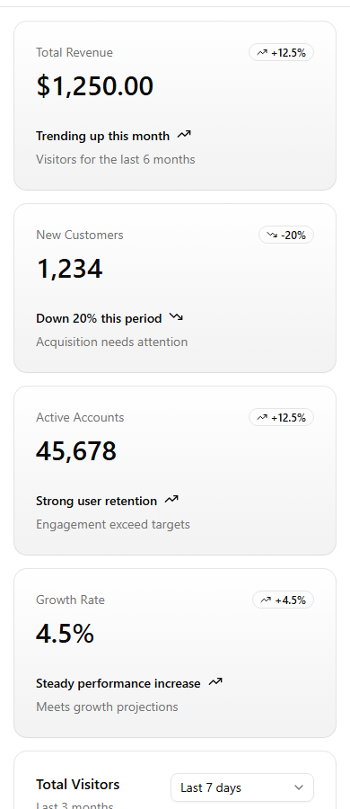 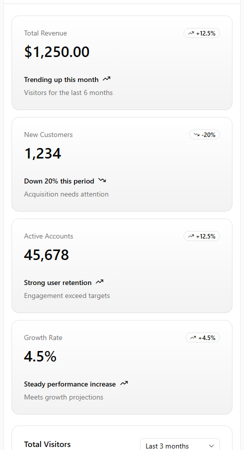 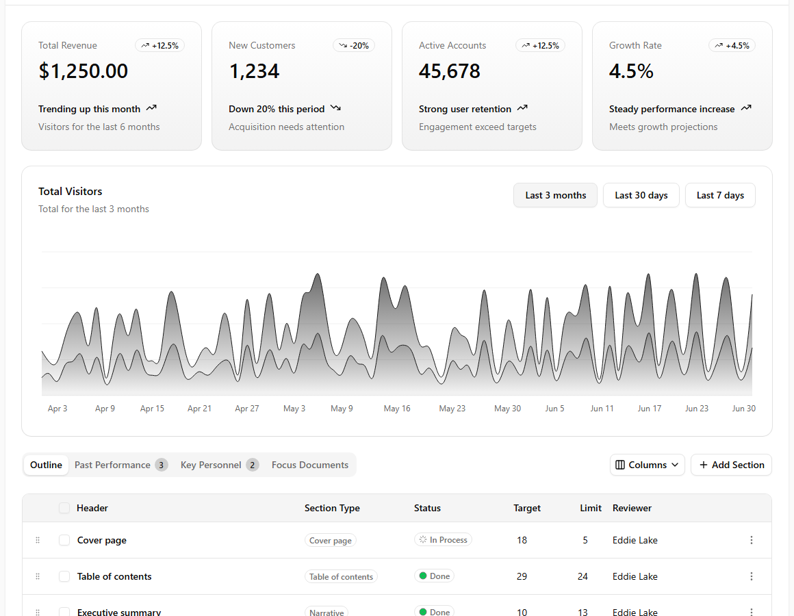

Widths: 390px, 768px, 1440px.

## Stat card row

From `dashboard-01`. Up to four KPI cards of one structure. One column, two when the page column is wide, four when it is very wide. The cards use `@container/card` so their value grows with the card.

```html
<div class="grid grid-cols-1 gap-4 px-4 lg:px-6 @xl/main:grid-cols-2 @5xl/main:grid-cols-4">
   …    {# ×4 #}
</div>
```

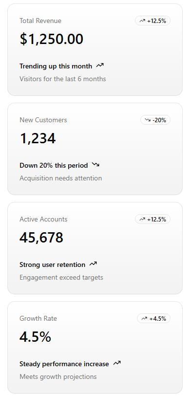 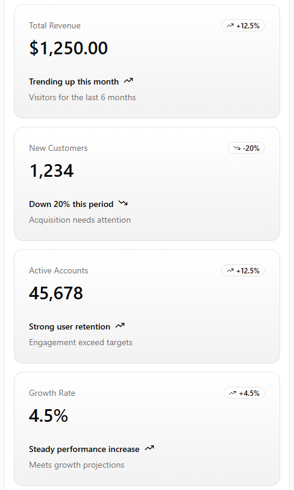 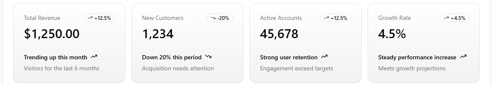

Widths: 390px, 768px, 1440px.

## Card that adapts to its width

From `dashboard-01`. A card is a container; its parts switch at the card width, not the window width: `@[250px]/card:text-3xl` for a KPI value, `@[540px]/card:block` for a longer description, `@[767px]/card:flex` to show a toggle group instead of a select.

```html

  
    {{ ui.card_title(text='Total Visitors') }}
    <span class="hidden @[540px]/card:block">Total for the last 3 months</span><span class="@[540px]/card:hidden">Last 3 months</span>
     …toggle group `hidden @[767px]/card:flex`, select `@[767px]/card:hidden`… 
  

```

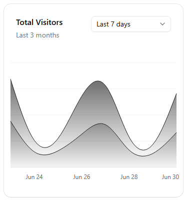 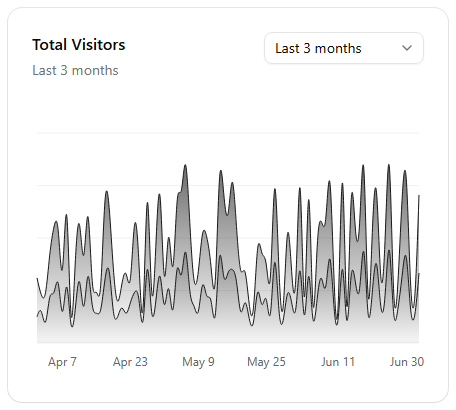 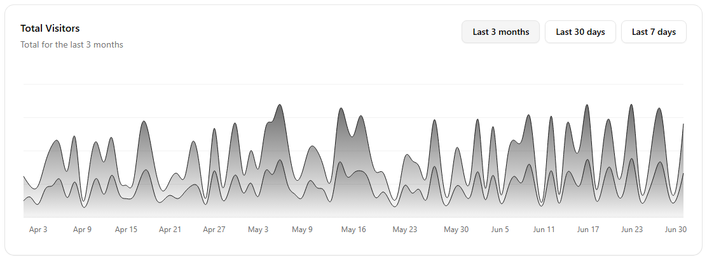

Widths: 390px, 768px, 1440px.

## Content tiles

From `sidebar-07`. Three equal tiles above a main area (every sidebar block). sidebar-12 uses five columns (`md:grid-cols-5`). The main area below is `min-h-[100vh] flex-1 rounded-xl md:min-h-min`.

```html
<div class="flex flex-1 flex-col gap-4 p-4 pt-0">
  <div class="grid auto-rows-min gap-4 md:grid-cols-3"> …three tiles… </div>
  <div class="min-h-[100vh] flex-1 rounded-xl md:min-h-min"> …main area… </div>
</div>
```

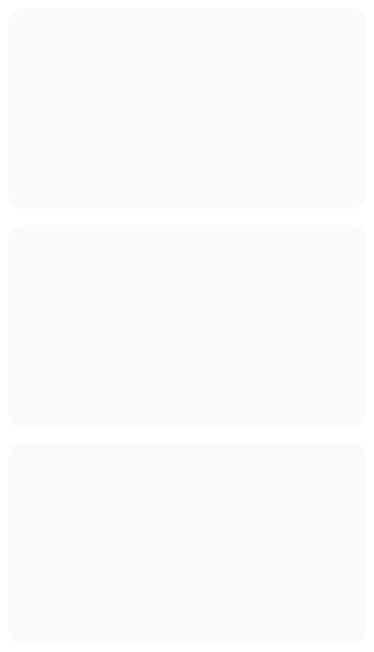 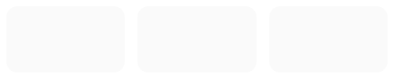 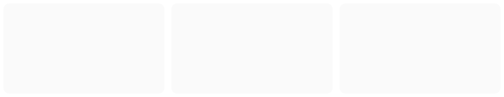

Widths: 390px, 768px, 1440px.

## Centred form

From `login-01`. A single card form centred on the page, at most `max-w-sm` wide (sign in, sign up, short forms). Fields inside are a `FieldGroup`, which is a container (`@container/field-group`).

```html
<div class="flex min-h-svh w-full items-center justify-center p-6 md:p-10">
  <div class="w-full max-w-sm"> …FieldGroup… </div>
</div>
```

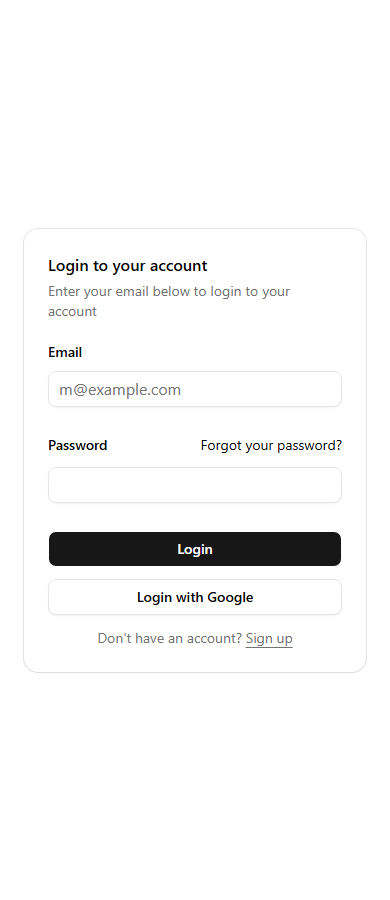 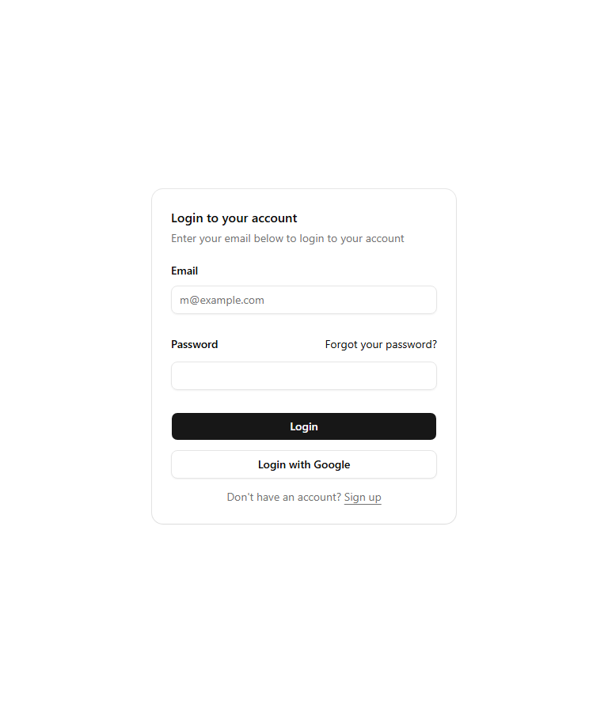 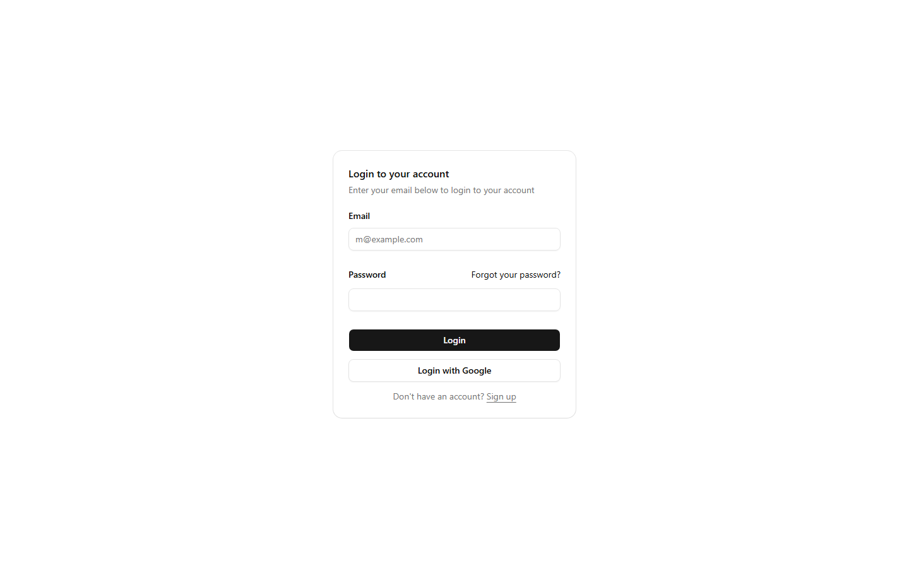

Widths: 390px, 768px, 1440px.

## Split screen

From `login-02`. Form on one half, cover image on the other, from 1024px wide; the form column is `max-w-xs`.

```html
<div class="grid min-h-svh lg:grid-cols-2">
  <div class="flex flex-col gap-4 p-6 md:p-10"> …logo, form `w-full max-w-xs`… </div>
  <div class="relative hidden bg-muted lg:block"> …cover image… </div>
</div>
```

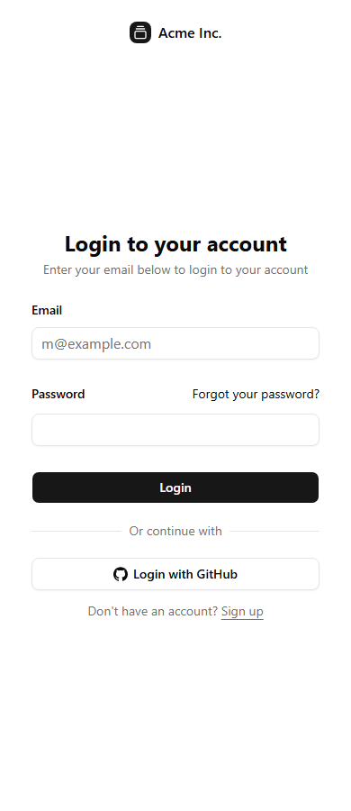 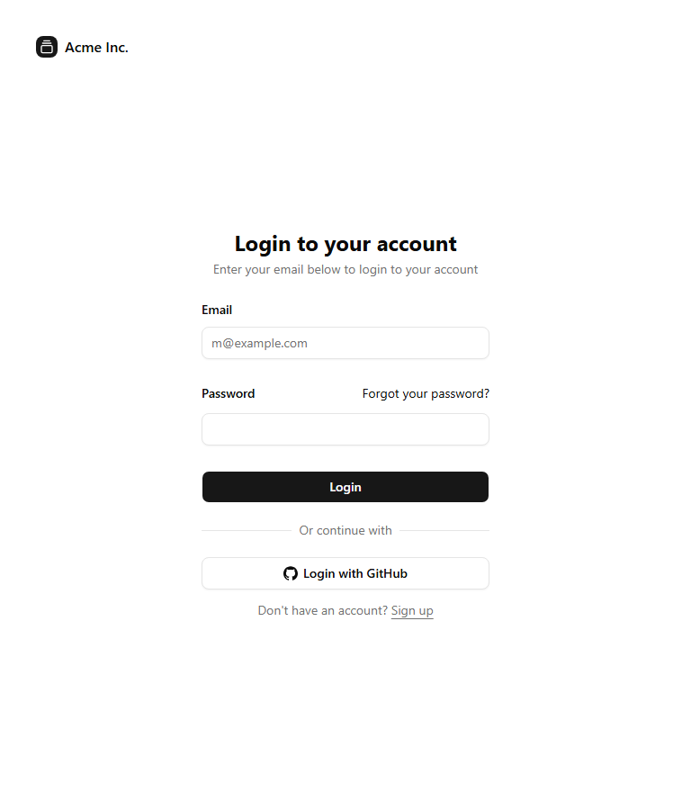 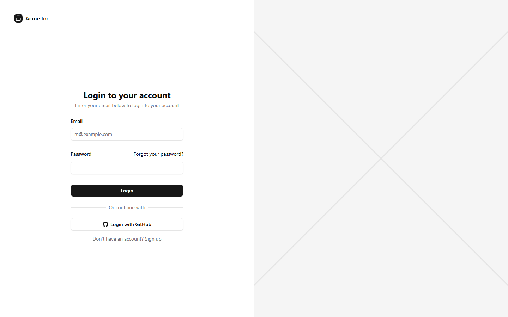

Widths: 390px, 768px, 1440px.

## Card split in two

From `login-04`. A form and an image side by side inside one card, from 768px wide; the card column is `w-full max-w-sm md:max-w-4xl`.

```html
<div class="w-full max-w-sm md:max-w-4xl">
  
    <form class="p-6 md:p-8"> … </form>
    <div class="relative hidden bg-muted md:block"> …image… </div>
  
</div>
```

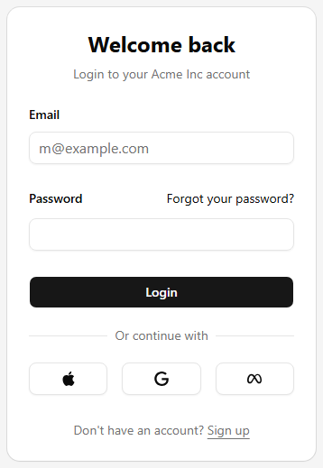 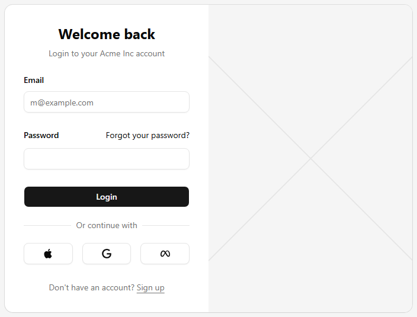 

Widths: 390px, 768px, 1440px.

## Paired fields

From `signup-03`. Two short fields on one row inside a form (password and confirmation). From 640px only: `grid gap-4 sm:grid-cols-2` (login-05, signup-05). Three provider buttons: `grid grid-cols-3 gap-4` (login-04).

```html

   …password… 
   …confirm… 

```

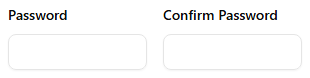  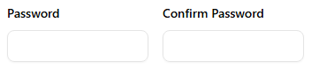

Widths: 390px, 768px, 1440px.

## Chart grid

From the upstream charts page (`compliance/upstream/shadcn/charts-app/page.tsx`). Chart cards two to a row from 768px and three from 1024px; a chart that needs the full width spans the row (`md:col-span-2 lg:col-span-3`).

```html
<div class="grid flex-1 scroll-mt-20 items-stretch gap-10 md:grid-cols-2 md:gap-6 lg:grid-cols-3 xl:gap-10">
   …chart… 
   …full-width chart… 
</div>
```

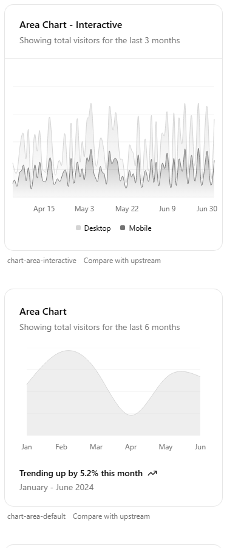 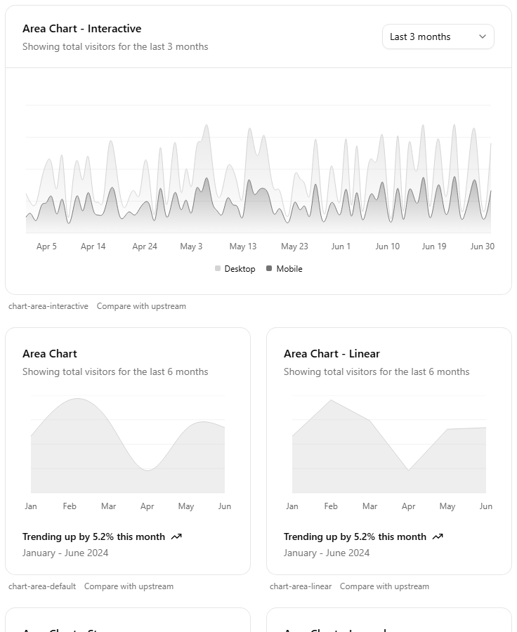 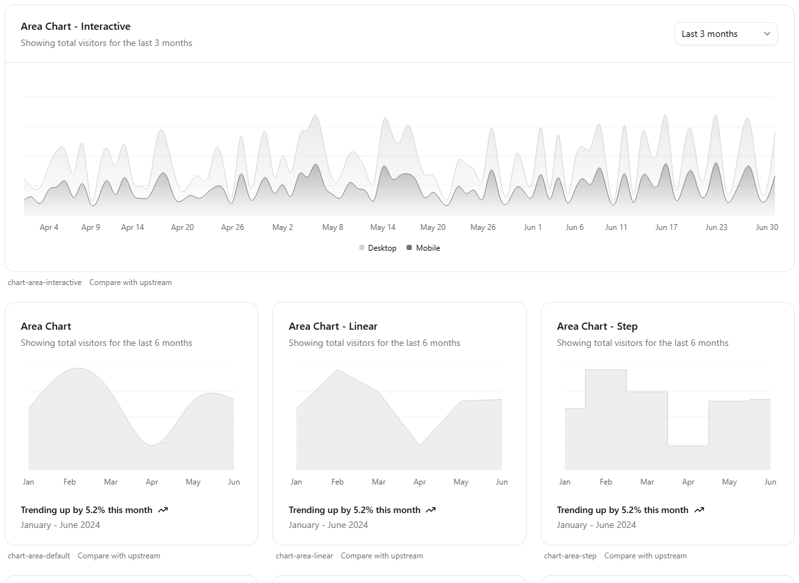

Widths: 390px, 768px, 1440px.
